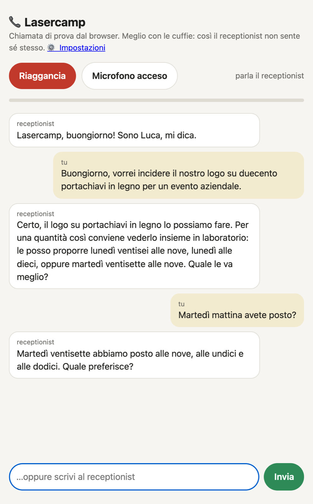
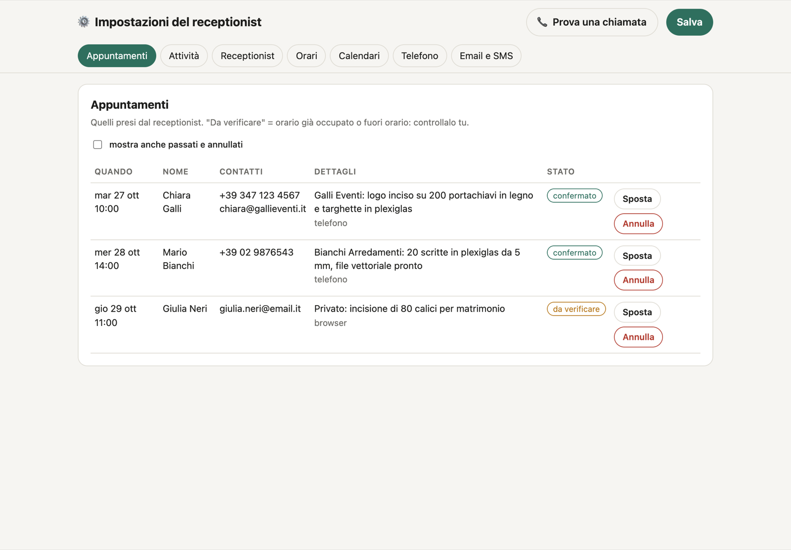
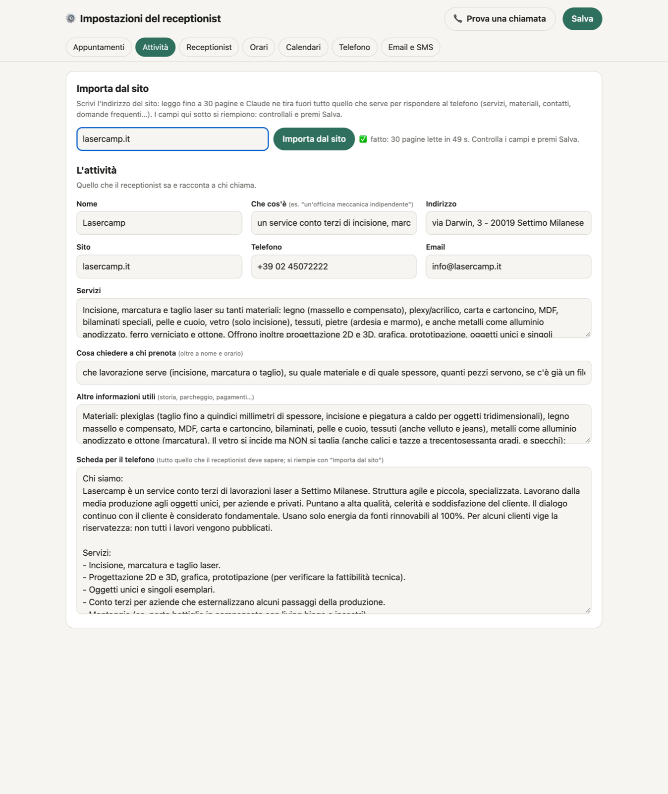
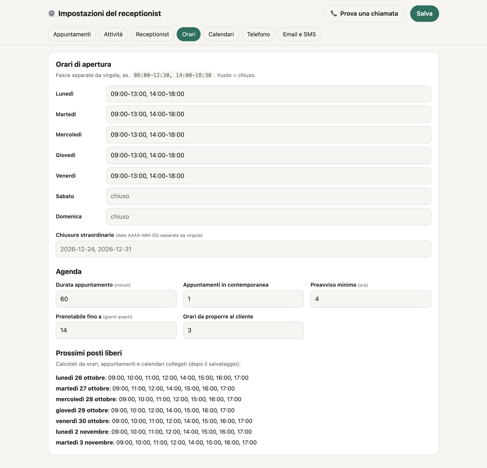
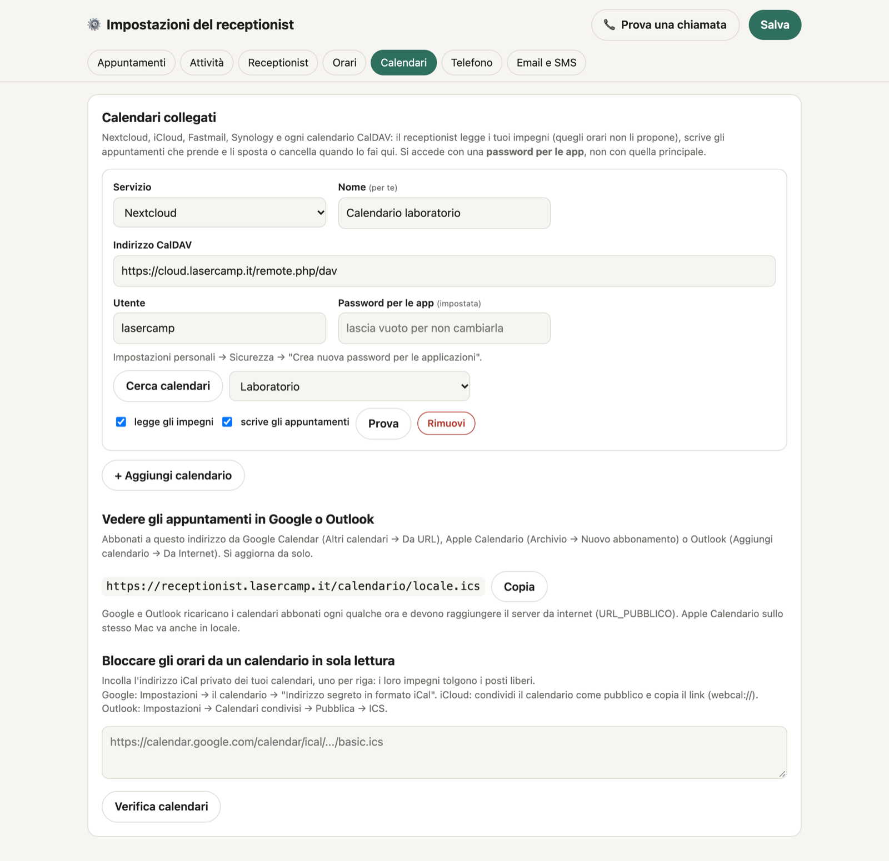
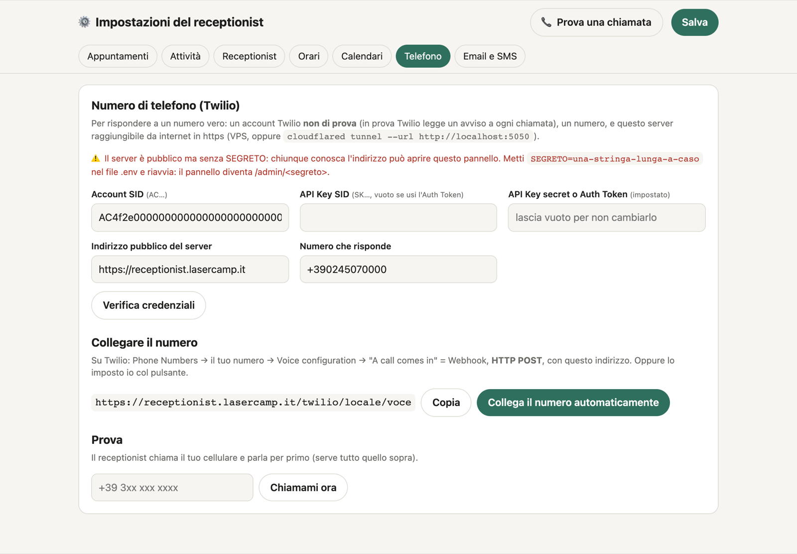

# AI Receptionist, fully local

This is a fork of [Henry12034/ai-caller-cosmio](https://github.com/Henry12034/ai-caller-cosmio), the AI receptionist from [Cosmio](https://cosmio.it), rewritten to run entirely on your own machine.

Italian version: [README.it.md](README.it.md) · Technical guide (Italian): [GUIDA-TECNICA.md](GUIDA-TECNICA.md)

🎧 [Listen to a call](demo/telefonata-lasercamp.mp3) (Italian, the Lasercamp example below) · [A second simulated call](demo/telefonata-locale.mp3)

## Contents

1. [What it is and what it does](#what-it-is-and-what-it-does)
2. [Why local](#why-local)
3. [Architecture](#architecture)
4. [Requirements](#requirements)
5. [Quick start](#quick-start)
6. [The admin panel, tab by tab](#the-admin-panel-tab-by-tab)
7. [The brain: Claude Code and other services](#the-brain-claude-code-and-other-services)
8. [Languages](#languages)
9. [Calendars](#calendars)
10. [Confirmation emails and SMS](#confirmation-emails-and-sms)
11. [Twilio: a real phone number](#twilio-a-real-phone-number)
12. [Import from your website](#import-from-your-website)
13. [The voice](#the-voice)
14. [How a call works](#how-a-call-works)
15. [How it adapts to the caller](#how-it-adapts-to-the-caller)
16. [Security and privacy](#security-and-privacy)
17. [Worked example: Lasercamp](#worked-example-lasercamp)
18. [Status and limitations](#status-and-limitations)
19. [Repository layout](#repository-layout)
20. [License and credits](#license-and-credits)

## What it is and what it does

A receptionist that answers the phone for a small business. It greets the caller, works out what they need, offers free appointment slots, writes the appointment into your calendar and ends the call. Speech recognition and the voice run on your Mac; the "brain" that decides what to say is Claude Code by default, or any OpenAI-compatible service.

**The calls are in Italian** (German is an optional extra, see [Languages](#languages)). The examples in this README are real Italian dialogue, with English translations next to them.

What it does:

- **Answers every call**, at any hour, weekends included, with no hold music (the voice engine handles one call at a time, see the limitations).
- **Books appointments.** It proposes the first free slots (the number is configurable), asks for the name and for whatever your business needs (for example material and quantity), repeats the summary and writes the appointment. Only slots that are really free are offered: opening hours, existing appointments and your external calendars are all taken into account.
- **Talks like a person.** Short sentences, no lists, numbers and dates spelled out so the voice reads them well. If the caller talks over it, it stops and listens.
- **Does not invent.** No prices, lead times or promises. Anything it does not know is passed to a human ("the technicians will tell you").
- **Is honest about being an AI.** If asked, it says yes and offers a call back from a person.
- **Closes the call by itself**, repeating day and time. Optionally sends a confirmation email and an SMS.

## Why local

- **No per-minute cloud voice bill.** Listening and speaking run on the Mac with open models (Parakeet v3, Qwen3-TTS on MLX). The only part that can leave the machine is the text of the conversation, sent to the brain you choose.
- **Audio never leaves the Mac.** With Claude Code or a paid API, only transcribed text goes out. With a free tier of some services, customer names and phone numbers pass through that service, which matters under GDPR (see [Security and privacy](#security-and-privacy)).
- **Everything is editable.** Tone, rules and call flow are in one file (`src/persona.mjs`); the rest is a small Node server and a small Python engine. No framework, two npm dependencies (`ws`, `nodemailer`).

## Architecture

```
                        ┌──────────────────────────────────────────────────────┐
 phone (Twilio) ───┐    │ Node server  (src/, port 5050)                        │
   μ-law 8 kHz     │    │                                                      │
   Media Streams   ├───▶│  VAD (energy)  ──▶  end of sentence                  │
                   │    │                         │ PCM 8 kHz                  │
 browser ──────────┘    │                         ▼                            │
   microphone / chat    │               ┌───────────────────┐  HTTP :5051      │
   (same protocol)      │               │ Python engine     │◀────────────────┐│
                        │               │ motore/motore.py  │                 ││
                        │               │ /stt  Parakeet v3 │  (MLX, Apple GPU)│
                        │               │ /tts  Qwen3-TTS   │                 ││
                        │               └───────────────────┘                 ││
                        │                         │ text                      ││
                        │                         ▼                           ││
                        │  brain (src/cervello.mjs)                           ││
                        │   ├─ Claude Code: `claude -p` stream-json           ││
                        │   └─ or any OpenAI-compatible API (+ fallback)      ││
                        │                         │ streamed text             ││
                        │                         ▼                           ││
                        │  split into sentences ──▶ /tts ──▶ μ-law ──▶ caller ┘│
                        │  markers <<CONFIRM…>> / <<END>> ──▶ calendar, email  │
                        └──────────────────────────────────────────────────────┘
```

In short: **phone (Twilio) or browser → Node server → Python engine (Parakeet v3 for listening, Qwen3-TTS on MLX for speaking) → brain (Claude Code, or an OpenAI-compatible service) → back to the voice.**

Key points:

- **One protocol.** Twilio and the browser page speak the same Media Streams protocol (μ-law 8 kHz, `mark`, `clear`), so both go through the same pipeline in `src/chiamata.mjs`. The browser page also shows the transcript and lets you type to the receptionist like a chat.
- **Separate engine process.** Transcription runs in its own process so it never waits for the voice to finish generating.
- **No tools for the brain.** The model cannot call anything. To book an appointment or hang up it writes markers at the end of its answer, which the server executes and the caller never hears.

## Requirements

| | |
|---|---|
| Computer | Mac with Apple Silicon (MLX). 16 GB of RAM is enough. |
| Node.js | 20.12 or newer |
| Python | 3.11 or newer, with `pip install -r motore/requirements.txt` (`mlx-audio`, `faster-whisper`, `numpy`, `scipy`, `soundfile`). The first start downloads the models from Hugging Face (about 1.5 GB). |
| Brain | [Claude Code](https://claude.com/claude-code) installed and logged in (`claude` works in the terminal), **or** an API key for another service, see below |
| ffmpeg | On the PATH, **only for the no-phone tests** (`prove/genera-cliente.mjs` and `prove/finto-twilio.mjs`); not needed to run the receptionist |
| Optional | A Twilio account and a public HTTPS address (a Cloudflare Tunnel is fine), only if you want a real phone number |

## Quick start

```bash
npm install
pip install -r motore/requirements.txt
cp .env.example .env        # the defaults are fine for a local test

npm run motore              # terminal 1: ears and voice. Wait for "Motore vocale pronto"
npm start                   # terminal 2: the server
```

- Open **http://localhost:5050**, press the call button and talk (headphones recommended, otherwise the speaker echo can interrupt the receptionist), or type in the chat.
- The settings are at **http://localhost:5050/admin**.
- **Without `SEGRETO` the server is for this computer only.** It listens on `127.0.0.1` (`HOST`) and answers 403 to any request with a `Host` name other than `localhost`, `127.0.0.1` or `[::1]`, or with proxy or tunnel headers (`X-Forwarded-For`, `CF-Connecting-IP`...). To use it from the internet you need a long random `SEGRETO` and an https proxy in front (see [Security and privacy](#security-and-privacy)).



A simulated phone call, going through exactly the same path as Twilio (the engine must be running):

```bash
npm run genera-cliente      # once: creates the voice of the test customer
npm run prova               # runs prove/esegui.sh: starts the server, makes a call, prints delays
```

The main `.env` options:

| Variable | Default | Meaning |
|---|---|---|
| `PORTA` | `5050` | Server port |
| `HOST` | `127.0.0.1` | Address the server listens on. `0.0.0.0` opens it to the network: only behind an https proxy and with `SEGRETO` |
| `SEGRETO` | empty | Empty = localhost only (refuses non-local `Host` and proxies/tunnels). For the internet it is **mandatory**: a long random string (see [Security](#security-and-privacy)) |
| `URL_PUBBLICO` | empty | Public HTTPS address, only for Twilio |
| `DATI_DIR` | `./dati` | Folder for settings and appointments; for separate test instances |
| `MOTORE_PORTA` / `MOTORE_URL` | `5051` / `http://127.0.0.1:<MOTORE_PORTA>` | Voice engine port, and the address the server uses to reach it |
| `CLAUDE_MODELLO` | `haiku` | Claude model (`haiku` is the most responsive on the phone) |
| `CLAUDE_IMPEGNO` | `low` | `--effort` level; `low` gives the fastest first text |
| `STT_MODELLO` | `mlx-community/parakeet-tdt-0.6b-v3` | Or a faster-whisper model (`small`, `large-v3-turbo`, ...) |
| `TTS_TEMPERATURA` | `0.6` in the code | Lower = flatter and steadier voice, higher = more expressive and less predictable |
| `VAD_SOGLIA` | `700` | Energy above which it is voice (raise it with background noise) |
| `VAD_SILENZIO_MS` | `750` | Silence after which the caller has finished |
| `VAD_INIZIO_MS` / `VAD_MINIMO_MS` | `120` / `250` | Continuous voice needed to say "they are speaking" / sentences shorter than this are noise |
| `VAD_INTERRUZIONE_MS` | `500` | Continuous voice needed to interrupt the receptionist while it speaks |
| `RIEMPITIVO_S` | `-1` | If Claude is slow by this many seconds, it says "Sì, un attimo." (`-1` = never) |
| `TTS_ISTRUZIONI` | empty | Style instructions, only for CustomVoice models (no voice sample) |
| `TWILIO_AUTH_TOKEN` | empty | The account's primary Auth Token: verifies the signature of incoming Twilio calls (see [Twilio](#twilio-a-real-phone-number)) |
| `TWILIO_API_BASE` | `https://api.twilio.com` | **Tests only**: a fake Twilio instead of the real API (`prove/finto-twilio-api.mjs`) |
| `ALLOW_PRIVATE_FETCH` | empty | `1` = website import may read private or local addresses (see [Import from your website](#import-from-your-website)) |
| `NOME_RECEPTIONIST` / `GENERE_RECEPTIONIST` | `Luca` / `m` | Starting values; also editable in the panel |

More variables (`TWILIO_NUMERO`, `TWILIO_ACCOUNT_SID`, `TWILIO_API_KEY`, `TWILIO_API_SECRET`, `STT_MODELLO`, `TTS_MODELLO`, `TTS_VOCE`, `SPEGNI_SERVIZI`, `CON_SMS`...) and the defaults read from the code are in the [technical guide](GUIDA-TECNICA.md#variabili-del-env) (Italian); `.env.example` lists them with a comment. Almost everything about the business is edited in the admin panel and saved in `dati/impostazioni.json`.

> `motore.py` also stops the launchd services listed in `SPEGNI_SERVIZI` while it runs and restarts them when it exits (the default list is two other Qwen3-TTS servers on the author's Mac). If you have none, nothing happens; set `SPEGNI_SERVIZI=` to be sure it never touches anything.

## The admin panel, tab by tab

Everything is edited at `/admin` (or `/admin/<SEGRETO>`), and changes apply from the next call. Data lives in `dati/impostazioni.json` and `dati/appuntamenti.json`.

| Tab | What it does |
|---|---|
| **Appuntamenti** (Appointments) | Appointments taken by the receptionist, with **Move** and **Cancel** (also in linked calendars). "Da verificare" (to check) means the caller got a time that was already taken or outside opening hours: look at it yourself. At the top there are also the **promised callbacks** ("a colleague will call you back"): name, phone number and reason; once called back, press **Fatto**. |
| **Attività** (Business) | Name, address, phone, email, services, what to ask a booking caller, the "phone sheet" (everything the receptionist should know). The **Import from website** box is here. |
| **Design** | Logo, accent colour and theme of the browser call page and of the "Chiamami ora" panel, with a **live preview** as you change them. Empty = the default look. It fills itself in with **Importa dal sito** or with the **Prendi logo e colore dal sito** button (reads just the home page). |
| **Receptionist** | Name, gender (for Italian "pronto/pronta"), greeting, extra instructions, German on/off. |
| **Orari** (Hours) | Opening hours per day, one-off closures, appointment length, how many in parallel, minimum notice, how far ahead, how many slots to propose, and the list of upcoming free slots. |
| **Calendari** (Calendars) | CalDAV accounts, the subscription feed, private iCal addresses that block hours. |
| **Cervello** (Brain) | Which service answers calls, an optional fallback, and the test button. |
| **Telefono** (Phone) | Twilio credentials, automatic webhook, test call. |
| **Email e SMS** | SMTP settings, who gets notified, confirmation to the customer, SMS on/off. |

**Appointments**



**Business: import from the website.** Type the website address; the receptionist reads up to 30 pages and Claude extracts what is needed on the phone, without inventing what is not there. Fields fill in and you review them before saving.



**Hours and free slots**



**Calendars** (CalDAV, in read and write mode, plus the read-only options)



**Phone** (Twilio)



The Receptionist, Brain and Email/SMS tabs have no screenshot yet; they are plain forms, described in the sections below.

## The brain: Claude Code and other services

The "brain" is the service that understands the caller and writes the replies. You choose it in the **Cervello** tab. There is a main brain and an optional **fallback**.

| Service | Type | Notes |
|---|---|---|
| **Claude Code** | `claude -p` in streaming | Three ways to authenticate: the login already done on the computer (nothing to enter); a token from `claude setup-token` (`sk-ant-oat…`) pasted in the panel; or an Anthropic API key (`sk-ant-api…`). Models: `haiku`, `sonnet`, `opus`. |
| Groq | OpenAI-compatible | Free key at console.groq.com. Free limits are around 30 requests per minute. |
| Google Gemini | OpenAI-compatible | Free key at aistudio.google.com. The free tier has very few requests per day: better as a fallback. |
| OpenRouter | OpenAI-compatible | `:free` models. Without credit about 50 requests per day; with a one-off 10 USD top-up, 1,000. |
| Cerebras | OpenAI-compatible | May ask for a card before unlocking free credit. |
| Mistral | OpenAI-compatible | The free plan asks for phone verification. |
| OpenAI | OpenAI-compatible | Paid API key only. |
| Ollama | OpenAI-compatible | Local, free, no key; local models are slower, best as a last fallback. |
| IONOS AI Model Hub | OpenAI-compatible | Token from your IONOS contract. |
| Other | OpenAI-compatible | Any service with a `/v1` address and a key. |

How it behaves:

- **Claude Code** keeps one `claude -p --input-format stream-json --output-format stream-json --include-partial-messages` process open for the whole call: no tools, no MCP, no project settings, thinking disabled, with the instructions from `persona.mjs` as the system prompt. For Twilio calls it is started while the phone is still ringing.
- **OpenAI-compatible services** get one streaming request per caller sentence, with the full conversation history. Models that write their reasoning inside `<think>…</think>` are filtered so it is never spoken.
- **Automatic fallback.** If the main brain returns an error, hits its rate limit, or gives no first text within 9 seconds, the fallback answers the same sentence, with the conversation so far. A service that hit its limit is skipped for 60 seconds; one with a bad key for 10 minutes. If nothing answers, the caller hears a short apology and is asked to call back.
- **Test button.** "Prova una conversazione" runs a five-turn test conversation with the real instructions and checks that the brain writes the `<<CONFERMA|…>>` and `<<FINE>>` markers correctly, picks a day that is really free, writes numbers as words, uses no symbols and stays in Italian. It also shows the time to first text. No appointment is written.
- The model list is fetched from the service, so you do not type model names by hand.

**Honest warnings**

- **Free limits change often.** The numbers above are the ones written in the app and can be out of date next month. Check the service's own page before relying on a free tier.
- **You cannot connect a free ChatGPT or Gemini "chat" account.** Those are different products from the API. You need an API key (which may have a free tier, or not).
- **Free tiers and customer data.** With a free plan, customer names, phone numbers and emails said during calls go to that service, and some free plans may use the data to train models (Gemini outside the EU, Mistral free plan). That is a GDPR question you have to answer before using it for real customers. Claude Code on a paid plan, a paid API or a local Ollama avoid the question or make it easier.

## Languages

- **Italian is always on.** The greeting, the voice and the prompt are built for Italian, with a "Milanese professional" register (clear, direct, no dialect).
- **German, optional.** In the **Receptionist** tab, tick "Rispondi anche in tedesco". The greeting becomes Italian followed by German, and the receptionist answers **in the language of the caller**, even switching inside the same call. German is formal ("Sie"), numbers and dates are spelled out. The text inside the booking marker is always written in Italian. Parakeet v3 recognizes 25 European languages, and the voice is told per sentence which language to speak.
- Any other language: the receptionist politely says (in Italian and German) that it only speaks those two and offers a call back from a colleague. English-looking transcriptions are discarded as noise, because the speech recognizer tends to hallucinate short English phrases from echo and silence, so **English callers are not served**.

German is still being tested, see [Status and limitations](#status-and-limitations).

## Calendars

Free slots are computed from opening hours, appointments already taken, and your calendars.

**CalDAV (read and write).** Nextcloud, iCloud, Fastmail, Synology Calendar, mailbox.org, Zoho, Yahoo, Radicale, Baïkal and any other CalDAV server, even several at once.

- You sign in with a user name and an **app password** (not your main password). "Cerca calendari" (find calendars) discovers the calendars starting from just the server address; "Prova" reads the events as a check.
- **Reads** the events of the next days, recurring ones included (expanded by the server), and does not offer those times. They are re-read every 5 minutes and right after each change.
- **Writes** every appointment it takes. When you **move** or **cancel** an appointment in the panel, the event is updated or deleted in the calendar. Events written by the receptionist have a UID ending in `@ai-caller-locale` and do not count as busy time.
- Google Calendar does not accept app passwords over CalDAV, so for Google use the two options below.

**Read-only options**

- **Subscription feed.** `/calendario/<SEGRETO>.ics` can be added as a subscription in Google Calendar, Apple Calendar or Outlook, and shows the appointments. Google and Outlook reload subscribed calendars every few hours and need to reach your server from the internet.
- **Private iCal addresses.** Paste the secret iCal address of your calendars (Google "secret address in iCal format", iCloud public link, Outlook published ICS), one per line: their events remove free slots. They are read every 5 minutes; here recurring events count only on their first occurrence.

## Confirmation emails and SMS

- **Email (SMTP).** Set the server, port, user and password in the **Email e SMS** tab (Gmail: `smtp.gmail.com`, port 465 with "secure" on, an app password). For every booking an email goes to the owner (addresses separated by commas) and, if the caller spontaneously gave an email address, a confirmation goes to them. Both carry an `.ics` event. A "send a test email" button checks the settings. The receptionist never asks for the email; it only uses it if the caller offers it.
- **SMS.** With Twilio configured and "SMS attivi" ticked (or `CON_SMS=1`), the caller's number gets a text with day and time.

## Twilio: a real phone number

For a real number you need a Twilio account that is **not** a trial one (a trial account plays a notice at every call), a number, and the server reachable over HTTPS (a VPS, or `cloudflared tunnel --url http://localhost:5050`). All of it is done in the **Telefono** tab:

1. Put `SEGRETO` (a long random string) in `.env` and restart: the panel becomes `/admin/<SEGRETO>`.
2. Enter the public address of the server.
3. Enter the Account SID and an API Key (SK… plus secret) or the Auth Token, then press **Verifica credenziali**: it shows the account name, whether it is a trial account, and the numbers you own. Also fill in **Auth Token dell'account** (see below): you need the account's **primary** Auth Token even if you use an API Key for the API calls.
4. Choose the number and press **Collega il numero automaticamente**: the server sets "A call comes in" on Twilio to the webhook `https://…/twilio/<SEGRETO>/voce` (HTTP POST). Or copy the address and paste it by hand.
5. **Chiamami ora** (call me now) makes the receptionist call your mobile and speak first.

Credentials are stored in `dati/impostazioni.json`; the secret and the Auth Token are never sent back to the browser. `TWILIO_*` and `URL_PUBBLICO` in `.env` are only starting values.

**Call signature (`X-Twilio-Signature`).** With the Auth Token set (the panel field or `TWILIO_AUTH_TOKEN`; if your credentials are Account SID plus Auth Token, that one already counts) the webhook only accepts requests signed by Twilio and answers 403 to the rest. Twilio always signs with the primary Auth Token, never with an API Key secret. The signature is computed on the public address, so **if the Auth Token is set but the public address is missing, requests are rejected**. **Without an Auth Token** the request goes through (knowing the address with the secret is enough) and the Phone tab warns you.

## Import from your website

In the **Attività** tab, type the address of the business website and press **Importa dal sito**.

- It reads **up to 30 pages of the same domain**: first the home page and pages with names like contacts, services, prices, FAQ, about, and the pages listed in `sitemap.xml`. Menus and footers repeated on every page are removed.
- The text is sent to Claude (Sonnet when the brain is Claude Code; otherwise the model you configured), which returns the business fields, the **greeting** and a complete **phone sheet** (services, materials and technical limits, contacts, FAQ), using only what is on the site. Prices are included only if the site states them. If the main brain fails, the request goes to the fallback brain (if you set one).
- Opening hours are filled in **only if the site really gives them**. The panel also tells you what it did not find.
- Besides the phone data, from the home page it also takes the **logo and the main colour of the site** (`og:image` or the site icon; `theme-color` or the most-used colour in the stylesheets) and carries them into the **Design** tab, which changes the look of the browser call page and the "Fatti chiamare" panel. If they are not found, those stay as they were.
- Nothing is saved until you check the fields and press **Salva**.
- **Anti-SSRF check:** before reading, every address (and every redirect hop, at most 5) is checked: only `http` and `https`, the host name is resolved (all DNS answers) and if it points to a private, local or link-local network (127.0.0.0/8, 10.0.0.0/8, 172.16.0.0/12, 192.168.0.0/16, 169.254.0.0/16, `::1`, `fc00::/7`, `fe80::/10`) the import stops with a clear error. So the button cannot be used to make the server read pages of your internal network or cloud metadata services. With `ALLOW_PRIVATE_FETCH=1` in `.env` the private-network block is lifted (to import from an internal site); the server itself (`localhost:PORT`) stays excluded anyway. CalDAV and iCal addresses, instead, may sit on your network (a Nextcloud at home), but go through the same checks on scheme and redirects and can never point at the server itself.

The phone sheet goes into the model's instructions at every call (the first 8,000 characters), so you can edit it by hand to add what the site does not say.

## The voice

- The default voice is `voci/receptionist.wav`: a Milanese man of about 35, natural and professional, with `voci/testo.txt` as its transcript. It was **designed with Qwen3-TTS VoiceDesign** (a text description of the voice, `motore/disegna-voce.py`) and is then **cloned at every sentence** by the Qwen3-TTS 0.6B Base model. The sample contains no fillers ("allora", "ehm") because the clone would tend to repeat them.
- **Replacing it with another designed voice.** Change the description in `motore/disegna-voce.py` and run `python3 motore/disegna-voce.py 4` (four proposals). Listen to `voci/proposta-N.wav` and copy the best one (5 to 10 seconds) to `voci/receptionist.wav`. **Warning:** the script **rewrites `voci/testo.txt` on every run** with its own sample text (the script's `TESTO` variable, the same for all proposals), even if `receptionist.wav` did not change. After choosing a proposal, `voci/testo.txt` must contain exactly what is said in the sample you copied: if you trimmed the audio, trim the text too; if you changed `TESTO`, the file is already right for the new proposals but not for the old `receptionist.wav` until you replace it. If you re-run the script without replacing the active sample, fix the text back (or keep a copy first).
- **Cloning a voice of your own.** Record 5 to 15 seconds of clean speech, with no fillers, and write exactly what is said. Either replace the two files above or set `TTS_RIF_AUDIO` (a 24 kHz wav) and `TTS_RIF_TESTO` in `.env`. **Only clone a voice with the explicit consent of the person speaking**, and do not present a cloned real person as someone else to your callers.
- Without a sample the engine uses a built-in Qwen3-TTS CustomVoice speaker (`TTS_VOCE`), which has a slight foreign accent.
- `TTS_TEMPERATURA` controls how expressive it is.

## How a call works

1. **Greeting.** It is synthesized once and kept in memory, so it plays immediately. Claude starts in the background (for Twilio, while the phone rings).
2. **Listening (VAD).** A simple energy detector on the server decides when the caller has finished: `VAD_SILENZIO_MS` (750 ms) of silence ends the sentence, which goes to the engine for transcription. Very short sounds are treated as noise.
3. **Transcription.** Parakeet v3 on MLX. Transcriptions that look like silence hallucinations or English echo are dropped.
4. **Answer, streamed.** Claude's text arrives token by token. As soon as there is a whole sentence (at least 20 characters), or a comma in a long one, it goes to Qwen3-TTS, which returns audio in chunks while it generates. Sentences are sent whole because the 0.6B model can slip on fragments of two or three words.
5. **Interruptions.** If the caller talks over the receptionist, the server flushes the audio already queued (`clear`), stops the synthesis and ignores the rest of the answer. While the receptionist is speaking, a louder and longer voice is required to interrupt, so speaker echo or a cough does not silence it.
6. **Markers.** The model has no tools. At the end of its answer it writes `<<CONFERMA|name|YYYY-MM-DD|HH:MM|details|email>>` once the caller has confirmed everything (the e-mail is optional, only if the caller volunteered it), `<<RICHIAMA|name|reason>>` once when the caller accepts a callback from a colleague (it is listed at the top of the Appuntamenti tab, with no day or time), and `<<FINE>>` after the final goodbye. The server removes them from the spoken text, books the appointment or callback and hangs up after the last audio has played.

**Timings** measured on an Apple Silicon MacBook with 16 GB:

| Step | Time |
|---|---|
| Voice: first audio of a sentence | ~0.2 s |
| Transcription | ~0.1 to 0.2 s per sentence |
| Claude: first text (`--effort low`) | ~0.65 to 1.3 s |
| **Total, end of the caller's sentence to first audio** | **~1.5 to 2.5 s** |

These depend on the machine and its load; see the note in [Status and limitations](#status-and-limitations).

## How it adapts to the caller

The instructions tell the model to listen to how the caller speaks and change the manner, never the courtesy or the accuracy:

| Caller | What the receptionist does |
|---|---|
| In a hurry | Very short answers, one thing at a time, no pleasantries |
| Rude or provocative | Stays calm and friendly, no apology, no lecture, maybe a light joke, then moves on |
| Worried (accident, breakdown, deadline) | Calm and close, the person first and then the job, never jokes |
| Angry about a problem | Does not defend itself or promise anything, says it will note it and offers a call back from a person |
| Talkative | Answers in one sentence and steers back to what is missing |
| Disorganized | Keeps everything said, never asks again for something already given |
| Unsure | Slower, simple words, one easy question at a time, proposes the simplest path |
| Informal (uses "tu") | Switches to "tu" and relaxes, still professional; stays on "Lei" with formal callers |
| Asks what it does not know (prices, times, guarantees) | Says frankly it cannot tell right now and who will |
| Off topic or selling something | Short and polite, then ends the exchange gracefully |

## Security and privacy

- **`SEGRETO`.** Without it the server assumes it is only used locally. For a public server set `SEGRETO` to a long random string: the panel moves to `/admin/<SEGRETO>`, the web call page to `/web/<SEGRETO>`, the feed to `/calendario/<SEGRETO>.ics` and the Twilio webhook to `/twilio/<SEGRETO>/voce`. **Do not expose the panel without a secret**: anyone who knows the address could read customer data and change settings (the Phone tab warns you in red). The secret in the URL protects the panel and the API; the Twilio webhook also has signature verification (see below).
- **Localhost only, by default (`HOST`).** The server listens on `127.0.0.1` (`HOST`). With `HOST=0.0.0.0` it opens to the local network: only do that behind an https proxy and with `SEGRETO`.
- **Without `SEGRETO` it refuses proxies and tunnels.** The server answers 403 (and closes WebSockets) to any request with a `Host` name other than `localhost`, `127.0.0.1` or `[::1]`, or with proxy headers (`cf-connecting-ip`, `x-forwarded-for`, `x-forwarded-host`, `x-real-ip`, `forwarded`). So a tunnel or proxy put by mistake in front of a server without a secret does not publish the panel. **For the internet:** `SEGRETO` is mandatory, plus an https proxy (or tunnel) in front, with `URL_PUBBLICO` set.
- **Twilio signature.** With the primary Auth Token set, the webhook verifies `X-Twilio-Signature` (HMAC-SHA1 over the public address) and answers 403 if it is missing or wrong. Without an Auth Token the request goes through but the panel warns you; with the Auth Token but no public address it is rejected. See [Twilio](#twilio-a-real-phone-number).
- **Test WebSocket:** the special `prova` token of the call WebSocket (`/media/tel/prova`, used by local tests) is only valid for a direct connection from this computer, without proxy headers and with a local `Host`, and never when both `SEGRETO` and the public address are set (exposed server). For Twilio the WebSockets use single-use tokens valid for 60 seconds.
- **Keys.** API keys, tokens and passwords are stored in `dati/impostazioni.json` with permissions `600` (the `dati/` folder is `700`; at startup and at every save the permissions are reset to `700`/`600` even if the folder and files already existed with looser ones), and are **never sent back to the browser**: leaving a password field empty keeps the saved one. `.env` and `dati/` are in `.gitignore`.
- **Personal data on disk.** `registrazioni/` contains caller numbers and the text of calls, and `dati/appuntamenti.json` (also `600`) the bookings. Treat them under GDPR: decide a retention period and delete what you do not need. The audio is not kept.
- **Data leaving the Mac.** The text of the conversation goes to the brain you chose (see [warnings](#the-brain-claude-code-and-other-services)). Name, phone and email of customers are in that text.
- **Transparency and the AI Act.** The receptionist always admits to being an AI if asked. In the European Union the AI Act requires telling the caller **at the start** that they are talking to an AI: for real use, add it to the greeting (Receptionist tab, "Saluto"), for example "...Sono Luca, l'assistente virtuale di Lasercamp, mi dica."
- **Cloned voices.** Only with consent, see [The voice](#the-voice).

## Worked example: Lasercamp

[Lasercamp](https://lasercamp.it) is a laser-processing workshop in Settimo Milanese (Milan): engraving, marking and cutting on wood, plexiglass, leather, fabric and metals, for companies and private customers. This is how it is set up, step by step. Everything below was run in the local setup described in [Status and limitations](#status-and-limitations).

### 1. Import from the website

In **Attività**, type `lasercamp.it` and press **Importa dal sito**. In the run shown in the screenshot above it read **30 pages in about 49 seconds** and filled in:

- the business: name *Lasercamp*, what it is (a contract laser service), address, phone, email;
- the services and materials (including technical limits, such as that glass can be engraved but not cut);
- what to ask a caller: which process (engraving, marking or cutting), which material and thickness, how many pieces, whether the file is ready;
- the **phone sheet**: who they are, services, materials, contacts, FAQ, in short sentences grouped by topic.

The website gives no opening hours, so the importer leaves them empty and says so. Review the fields, fix what you want and press **Salva**.

### 2. Opening hours, set by hand

Since the site does not give them, in **Orari** we type the hours for Monday to Friday:

```
Mon-Fri   09:00-13:00, 14:00-18:00
Sat, Sun  (empty = closed)
```

Appointment length 60 minutes, one at a time, minimum notice and horizon as in the screenshot above. The "Prossimi posti liberi" list below shows what the receptionist will offer.

### 3. The voice

The default voice (a Milanese man, name "Luca") fits a workshop near Milan, so we keep it. To change it, see [The voice](#the-voice). Greeting: `Lasercamp, buongiorno! Sono Luca, mi dica.`

### 4. Calendar

In **Calendari** we link the workshop calendar over CalDAV (for example a Nextcloud server: address `https://<your-server>/remote.php/dav`, user, app password, then "Cerca calendari", choose the calendar, tick "legge gli impegni" and "scrive gli appuntamenti", "Prova"). From then on slots already busy in that calendar are not offered, and every booking is written into it. (The screenshot in the [Calendars section](#the-admin-panel-tab-by-tab) shows this form filled in with illustrative values; the feature was tested against a local Radicale server, see below.)

### 5. A test call and the resulting appointment

A simulated phone call, through the same path as Twilio, with a caller who wants engraved keyrings and plexiglass plates for a company event. The caller speaks **Italian**; the English is a translation added here.

| Italian (what is said) | English (translation) |
|---|---|
| **Receptionist:** Lasercamp, buongiorno! Sono Luca, mi dica. | Lasercamp, good morning! This is Luca, how can I help? |
| **Caller:** Buongiorno! Volevo delle informazioni per delle lavorazioni laser. | Good morning! I wanted some information about laser work. |
| **Receptionist:** Certo, mi dica pure. Le serve un taglio, un'incisione o una marcatura? | Of course, go ahead. Do you need cutting, engraving or marking? |
| **Caller:** Allora, per un evento della mia azienda vorremmo regalare dei portachiavi in legno con il nostro logo inciso. E magari anche delle targhette in Plexiglas. | Well, for an event of my company we'd like to give away wooden keyrings with our logo engraved. And maybe some plexiglass plates too. |
| **Receptionist:** Perfetto, quindi per l'azienda: portachiavi in legno con incisione del logo, e targhette in plexiglas. Quanti pezzi pensa di farne, più o meno? E avete già il file del logo? | Perfect, so for the company: wooden keyrings with the logo engraved, and plexiglass plates. About how many pieces? And do you already have the logo file? |
| **Caller:** Saranno più o meno 200 pezzi. Il logo ce l'ho. Ma non so se va bene per il laser. | About 200 pieces. I have the logo. But I don't know if it works for the laser. |
| **Receptionist:** Certo, si può verificare benissimo. Può mandare il logo a info@lasercamp.it, così i nostri grafici le dicono subito se è adatto all'incisione. [...] Intanto, vuole che le fissi un appuntamento in laboratorio per vedere i campioni e parlare del progetto? | Sure, that is easy to check. You can send the logo to info@lasercamp.it, so our designers can tell you right away if it suits engraving. [...] Meanwhile, would you like me to book an appointment at the workshop to see samples and talk about the project? |
| **Caller:** Ah perfetto, martedì alle 10 mi andrebbe benissimo. | Perfect, Tuesday at 10 would suit me very well. |
| **Receptionist:** Perfetto, martedì ventisette alle dieci è libero. A che nome lo segno? | Perfect, Tuesday the 27th at ten is free. What name shall I put it under? |
| **Caller:** Chiara Galli della Galli Eventi. | Chiara Galli of Galli Eventi. |
| **Receptionist:** Perfetto, segno Chiara Galli di Galli Eventi per martedì ventisette alle dieci. Quindi portachiavi in legno e targhette in plexiglas con incisione del logo, circa duecento pezzi, e ha già il file. È tutto così? | Perfect, I'm booking Chiara Galli of Galli Eventi for Tuesday the 27th at ten. So wooden keyrings and plexiglass plates with the logo engraved, about two hundred pieces, and you already have the file. Is that all? |
| **Caller:** Sì, è tutto. Le mando il logo per email allora. | Yes, that's all. I'll send you the logo by email then. |
| **Receptionist:** Perfetto, è tutto segnato. Lo mandi pure a info@lasercamp.it, così ce l'hanno prima di martedì. Le serve altro? | Perfect, it's all noted. Send it to info@lasercamp.it so they have it before Tuesday. Do you need anything else? |
| **Caller:** No, a posto così. Grazie mille. | No, that's it. Thank you very much. |
| **Receptionist:** Perfetto Chiara, ci vediamo martedì alle dieci. Buona giornata. | Perfect Chiara, see you Tuesday at ten. Have a good day. |

The excerpt is from a server log of a simulated call (the "customer" is a synthetic voice; the phone number in the log is a placeholder), lightly shortened where marked with `[...]`. At the end of the confirmation answer the server logged the marker:

```
🔧 CONFERMA ["Chiara Galli","2026-10-27","10:00","Galli Eventi, azienda: incisione logo su portachiavi
   in legno e targhette in plexiglas, circa 200 pezzi, file del logo da inviare via email"]
📅 appuntamento {"nome":"Chiara Galli","giorno":"2026-10-27","ora":"10:00","durata":60,"stato":"confermato","canale":"telefono", ...}
🔧 FINE
```

and the appointment appears in the **Appuntamenti** tab (first row of the screenshot above), is written to the linked calendar if there is one, and the 10:00 slot disappears from the free slots. A call that ends with `<<FINE>>` is hung up by the receptionist after the last audio has been played.

### What the receptionist does not know

Nothing about **prices, lead times, guarantees or whether a specific job is feasible** is on the website, so the receptionist does not make them up. It says it cannot tell right now and that the technicians will answer once they see the file or the object: that is why, in the call above, it sends the logo to the technical team instead of saying "yes, it works". Whatever you want it to say about those topics, add it to the phone sheet or the "extra instructions" field yourself.

## Status and limitations

What has been tested, honestly:

- Simulated phone calls that go through the same path as Twilio (a fake Twilio client that opens the Media Streams WebSocket and plays a synthetic customer voice), and calls and chat from the browser.
- **The Twilio link against a fake Twilio:** `prove/prova-twilio.mjs` (55 checks, with `prove/finto-twilio-api.mjs`) verifies the signature formula, the credentials, the number link, the webhook with and without a valid signature, the stream WebSocket, the outgoing call and the SMS, on a separate server instance.
- **Tone per type of caller:** `prove/matrice-tono.mjs` runs chat calls for eleven caller types (in a hurry, rude, worried, angry...) with automatic checks on digits, symbols, repeated sentences and invented facts; judging the tone is left to the reader. `prove/chat-prova.mjs` runs a chat-only call with the sentences you give it.
- **Security:** `prove/prova-sicurezza.mjs` checks the `prova` WebSocket token, the data permissions, old settings files and the anti-SSRF checks (the last check reads a real public website and needs network access).
- Calendars against a **local CalDAV server (Radicale)**.
- The OpenAI-compatible brain path against a **fake test service** that imitates the protocol.

What has **not** been tested yet:

- A **real Twilio number**: the webhook, the signature check, the automatic number link and the "call me now" button have been tested **only against a fake Twilio**, not a real one (the signature uses the formula documented by Twilio but has never been checked by a real request).
- **No test with a real Nextcloud** (nor iCloud, Fastmail, Synology...): only the local CalDAV server.
- **Real free-tier services** (Groq, Gemini, OpenRouter, ...), never tested beyond that fake test service. Their limits and behaviour may differ from what is described.

Known limits:

- **German and tone adaptation.** German was tested through chat and simulated calls: a caller who speaks German throughout, German switching to Italian and back, an English caller (the receptionist apologises in Italian and German and offers a callback), and German disabled (it stays in Italian and says so). Dates, times and e-mail addresses come out spelled in words in the right language, and the `<<CONFIRM…>>` details stay in Italian. The voice is the same cloned Italian-sounding speaker speaking German, so an accent is audible; it has not been tried with real German-speaking callers. The 11 customer-type scenarios in `prove/matrice-tono.mjs` were judged by reading the dialogues, not scored automatically. Haiku at low effort follows the tone rules only partly: it can occasionally get a relative date wrong ("tomorrow" on a Sunday) or slip an English word into Italian. Promised callbacks (an angry caller, one speaking another language, or one who prefers a person) are now recorded with the `<<RICHIAMA|name|reason>>` marker and appear at the top of the Appuntamenti tab: once called back, press "Fatto".
- **Short fragments.** Qwen3-TTS 0.6B can make mistakes on sentences of two or three words, so sentences are sent whole; the audio length is also capped.
- **One call at a time for the voice engine.** The engine handles one synthesis at a time (MLX works on one piece at a time), so concurrent calls would queue.
- **The voice is not a perfect native speaker.** It is good and consistent, but a careful Italian ear can tell it is synthetic.
- **Latency varies.** The timings above are what was measured on the development MacBook. Early test logs in this repository's development had longer delays (about 1.4 to 4 s from the end of the sentence), before `--effort low` and other changes, and loaded machines will be slower.
- **English callers are not served** (English-looking transcriptions are discarded as noise).
- **If you choose the faster-whisper engine** instead of Parakeet, transcription is forced to Italian, so German would not work.
- **Claude subscription on a public server.** Using a Claude subscription (login or `setup-token`) to answer calls on a public server should be checked against Anthropic's current usage limits and terms before you rely on it. An API key avoids the question.
- Recurring events in private iCal addresses count only at their first occurrence (CalDAV expands them properly).

## Repository layout

```
src/
  server.mjs         Twilio webhook, web page, admin panel, WebSocket
  chiamata.mjs       the pipeline: VAD → transcription → brain → voice, interruptions, actions
  cervello.mjs       the brain: Claude Code process or OpenAI-compatible services, fallback
  voce.mjs           client of the voice engine, μ-law encoding
  web.mjs            the page for calling from the browser (microphone + chat)
  persona.mjs        who the receptionist is, how it speaks, what it knows, how a call goes
  impostazioni.mjs   admin panel settings (dati/impostazioni.json)
  agenda.mjs         free slots, appointments, iCal calendars, confirmation emails
  caldav.mjs         CalDAV: search, read, create, move, delete
  sito.mjs           website import: page reading and data extraction
  admin.mjs          the admin panel page
  twilio.mjs         Twilio: credentials, check, automatic webhook, SMS, outgoing calls
  twilio-stream.mjs  Twilio side of the call: audio, marks, hang-up
  strumenti.mjs      appointment registration and confirmation SMS
  pannello.mjs       simple "call me" page
  config.mjs         reads .env and the starting values (port, engine, Claude, VAD)
  rete.mjs           requests to user-chosen addresses (website, CalDAV, iCal) with anti-SSRF checks
motore/
  motore.py          ears (Parakeet v3) and voice (Qwen3-TTS), all local
  disegna-voce.py    creates voice samples with Qwen3-TTS VoiceDesign
  requirements.txt
prove/               simulated calls, Twilio test with a fake Twilio, tone matrix, delay measurements
voci/                the receptionist voice sample (receptionist.wav, testo.txt)
demo/                two example calls (mp3)
docs/screenshot/     the screenshots used in this README
dati/                settings and appointments (created at runtime, git-ignored)
registrazioni/       call logs (created at runtime, git-ignored)
GUIDA-TECNICA.md     technical guide (Italian)
```

The code and its comments are in Italian (names such as `chiamata`, `cervello`, `agenda`, `impostazioni`); the technical guide is in Italian too.

## License and credits

**License: see below.**

<!-- TODO-LICENSE -->

Credits:

- Based on [Henry12034/ai-caller-cosmio](https://github.com/Henry12034/ai-caller-cosmio) by [Cosmio](https://cosmio.it) (originally built on OpenAI Realtime and ElevenLabs), itself inspired by [jasonc00person/bland-ai-receptionist](https://github.com/jasonc00person/bland-ai-receptionist).
- Speech recognition: [Parakeet TDT 0.6B v3](https://huggingface.co/nvidia/parakeet-tdt-0.6b-v3) by NVIDIA, licensed CC-BY-4.0.
- Voice: [Qwen3-TTS](https://huggingface.co/Qwen), Apache-2.0.
- Runtime: [MLX](https://github.com/ml-explore/mlx) and [mlx-audio](https://github.com/Blaizzy/mlx-audio) for running the models on Apple Silicon.
- Brain: [Claude Code](https://claude.com/claude-code) by Anthropic, or the OpenAI-compatible service you choose.
- Lasercamp ([lasercamp.it](https://lasercamp.it)) is used only as a realistic example of a small business; the example data comes from its public website.
